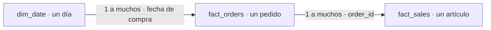

# Informe y modelo de datos para Power BI

El informe tiene dos páginas construidas: «Rendimiento comercial» y «Logística y clientes». Este documento describe su modelo, los criterios de validación y los pasos para reconstruirlo. Las capturas permiten revisar los resultados visibles; la comprobación de las medidas DAX y sus interacciones requiere revisar el informe en Power BI.

El modelo usa tres objetos de `olist_analytics`. El script [`07_create_and_validate_powerbi_model.sql`](../sql/07_create_and_validate_powerbi_model.sql) crea dos vistas: `analytics.fact_orders` y `analytics.dim_date`. Se puede ejecutar completo de nuevo: no requiere borrar ni recrear las tablas de origen. Requiere las tablas preparadas por `04` y `fact_sales` creada y actualizada según `05`; consultar los [requisitos y el orden de ejecución SQL](../sql/README.md).

Las vistas consultan las tablas preparadas por `04`. `fact_sales` sigue siendo la tabla creada por `05`; no se actualiza automáticamente al cambiar las tablas de analytics. Las comprobaciones de `07` detectan diferencias de conteos e importes entre ambas capas. Si un control de consistencia devuelve incidencias,
investigar antes de cargar Power BI. Estos controles muestran resultados; no reparan automáticamente los datos.

## 1. Ejecutar y comprobar en PostgreSQL

1. Conectar a `olist_analytics` y ejecutar completo `07`.
2. Confirmar que `fact_orders` tiene una fila por pedido, con clave no nula.
3. Confirmar que el calendario no tiene fechas repetidas ni días faltantes.
4. Los controles de artículos sin pedido, claves duplicadas/incompletas, discrepancias de tardanza e importes deben devolver cero.
5. Comparar los indicadores finales con las referencias de `06` y Pandas.

`fact_orders` conserva **todos los estados**, pedidos sin artículos y pedidos sin reseñas. Un pedido sin artículos tiene `item_count = 0`, pero su importe permanece NULL. Los promedios de reseñas consideran únicamente puntuaciones de 1 a 5. No se guarda una bandera fija de cliente recurrente: la recurrencia se calcula en DAX dentro del período y los estados del cliente seleccionados.

Si una instrucción falla dentro de la transacción, ejecutar `ROLLBACK` antes de reintentar. El bloque inicial detiene la creación si detecta claves inválidas en orders, customers u order_items.

## 2. Importar las tres tablas

En Power BI Desktop, usar el conector **Base de datos PostgreSQL**, indicar servidor y base `olist_analytics`, y elegir **Importar**. Para una instalación local con el puerto habitual, el servidor suele ser `localhost:5432`; usar los datos reales de tu instalación. Seleccionar estos objetos y renombrar sus consultas como se indica. El conector admite el modo Importar.

| Objeto de PostgreSQL | Nombre en Power BI | Una fila representa |
| --- | --- | --- |
| `analytics.dim_date` | `dim_date` | Un día. |
| `analytics.fact_orders` | `fact_orders` | Un pedido. |
| `analytics.fact_sales` | `fact_sales` | Un artículo de pedido. |

Comprobar los tipos en Power Query: identificadores como texto, `date` y `order_purchase_date` como fecha, banderas como verdadero/falso, conteos como números enteros. Los importes pueden usar decimal fijo; `review_score_avg` y `delivery_days` deben conservar precisión decimal, redondeando solo al presentar. No sustituir nulos de importes, puntuaciones o tardanza por cero/falso.

No combinar estas consultas mediante Merge en una única tabla plana: repetiría los importes y las calificaciones de pedidos con varios artículos. Tampoco es necesario importar las reseñas originales para las cinco preguntas actuales.

## 3. Relaciones

Crear exactamente estas dos relaciones activas y revisar cualquier relación detectada automáticamente. El filtro debe viajar del lado 1 al lado muchos.

| Lado 1 | Lado muchos | Dirección |
| --- | --- | --- |
| `dim_date[date]` | `fact_orders[order_purchase_date]` | Única: calendario → pedidos. |
| `fact_orders[order_id]` | `fact_sales[order_id]` | Única: pedidos → artículos. |

Este es un modelo simplificado de cabecera y detalle: `fact_orders` contiene métricas del pedido y transmite filtros a los artículos. No conectar además el calendario directamente a `fact_sales`, ni activar filtros bidireccionales.

Usar `dim_date[date]` como columna de la tabla de fechas para el modelo clásico de inteligencia temporal. La vista contiene años completos y días continuos. Ordenar `month_name` por `month_number`, y `year_month` por `year_month_number`. Para la evolución mensual, usar `year_month` en un eje categórico o `month_start` en un eje de fecha continuo. Ambos distinguen meses de diferentes años. `month_start` representa el primer día del mes como etiqueta de agrupación; no indica que el primer pedido se haya comprado ese día ni modifica el período elegido en el segmentador.

El calendario cubre años completos por razones de modelado; eso no significa que existan compras durante todos sus días. Para validar el proyecto, filtrar desde 04/09/2016 hasta 17/10/2018, inclusive. No convertir automáticamente meses sin observaciones en cero ventas ni comparar extremos como períodos completos.

## 4. Campos de referencia para los análisis

| Análisis | Campos de referencia |
| --- | --- |
| Ventas y categorías | `fact_sales[price]`, `product_category`; excluir importes negativos/nulos y mostrar incidencias. |
| Pedidos generales | `fact_orders[order_id]`; no contar filas de artículos. |
| Valor medio por pedido | Promedio de `fact_orders[merchandise_value_complete]`: omite pedidos sin detalle monetario completo. |
| Puntualidad | `fact_orders[is_delivery_evaluable]`, `is_delivered_late`, `delivery_status`, `delay_days`. |
| Satisfacción | Promedio de `fact_orders[review_score_avg]`, una fila por pedido; `has_valid_review` informa cobertura. |
| Calificaciones bajas | `is_low_review`; dividir por pedidos con `has_valid_review = TRUE`. |
| Recurrencia | Agrupar por `customer_unique_id` y contar pedidos entregados dentro del período y los estados del cliente seleccionados. Excluir identificadores vacíos. |
| Auditoría monetaria | `item_count`, `invalid_price_item_count`, `invalid_freight_item_count`, `has_complete_item_prices`. |

`merchandise_value_observed` y `freight_value_observed` son sumas disponibles por pedido; pueden ser parciales si existen incidencias. `merchandise_value_complete` es NULL si falta algún precio o hay precios negativos. Los ceros válidos se conservan.

Los importes por pedido y por artículo representan el mismo dinero a distinta granularidad: nunca sumar ambas columnas para calcular ventas. La calificación del pedido ya promedia sus reseñas válidas; no ponderarla por cantidad de reseñas.

Para ambas páginas, las medidas deben usar pedidos entregados e incorporar `fact_orders[is_delivered] = TRUE` para que el criterio no dependa únicamente de un filtro visual. Las tasas devuelven BLANK si no tienen denominador. Los porcentajes DAX se expresan como fracción 0–1 y se formatean como porcentaje; las referencias SQL usan escala 0–100.

### Comportamiento de filtros que hay que comprobar

- El calendario filtra pedidos y artículos.
- Un filtro de estado del cliente desde `fact_orders` filtra también las ventas.
- Una categoría de `fact_sales` filtra artículos, pero no regresa a `fact_orders`. Por eso los pedidos **por categoría** se cuentan con DISTINCTCOUNT sobre `fact_sales[order_id]`, no con un conteo de `fact_orders`.
- Ambas páginas utilizan segmentadores de período de compra y estado del cliente; la versión actual no incluye un segmentador de categoría. La recurrencia responde a esos dos filtros, pero no a categoría o vendedor. Su numerador y denominador deben usar la misma selección.
- Un futuro análisis de logística por categoría requiere transferir el conjunto de pedidos con una medida explícita; no resolverlo cambiando toda la relación a bidireccional.

Ocultar en la vista de informe los identificadores técnicos y las fechas, estados y atributos del cliente duplicados en `fact_sales`. Conservar sus columnas en el modelo si son útiles para validación. Usar las fechas de `dim_date` y los atributos del pedido de `fact_orders` en los segmentadores.

## 5. Validación de indicadores

Comparar con estas referencias usando el período 04/09/2016–17/10/2018, todos los estados del cliente y sin selecciones adicionales en los gráficos:

| Comprobación, ventana completa y entregados | Referencia |
| --- | ---: |
| Pedidos entregados | 96.478 |
| Artículos vendidos | 110.197 |
| Valor de mercancía | R$ 13.221.498,11 |
| Valor medio por pedido | R$ 137,04 |
| Pedidos evaluables | 96.470 |
| Pedidos tardíos | 6.534 |
| Tardanza | 6,77 % |
| Retraso medio entre pedidos tardíos | 10,62 días |
| Calificación media por pedido con reseña válida | 4,16 |
| Clientes compradores | 93.358 |
| Clientes recurrentes | 2.801 |
| Recurrencia | 3,00 % |

Comprobar también las medidas con selecciones de fecha y estado del cliente, las interacciones entre gráficos y el comportamiento sin datos. Las coincidencias en la ventana completa no verifican por sí solas todos los contextos de filtro. Las reglas se detallan en [Definición de indicadores](../report/definicion_indicadores.md), y las referencias de SQL en [referencias_sql](../report/referencias_sql/README.md).

## 6. Páginas del informe

### Rendimiento comercial

- Tarjetas: valor de mercancía, pedidos entregados, artículos vendidos y valor medio por pedido.
- Gráficos centrales: evolución mensual del valor de mercancía y pedidos entregados por mes.
- Gráficos inferiores: top 10 categorías y top 10 estados por valor de mercancía.

El valor de mercancía excluye flete y no representa ganancias de Olist. Los períodos se atribuyen a la fecha de compra de los pedidos entregados.

### Logística y clientes

- Tarjetas: porcentaje de entregas tardías, retraso medio, calificación media y porcentaje de clientes recurrentes.
- Gráficos centrales: entregas tardías por mes de compra y calificación media según puntualidad.
- Gráficos inferiores: top 10 estados por tasa de tardanza y clientes según frecuencia de compra.

El gráfico mensual de tardanza y el ranking de estados usan un mínimo de **100 pedidos evaluables por grupo**, dentro del período y los estados seleccionados. Aplicar el umbral al gráfico correspondiente, antes de seleccionar el top 10 en el ranking. Mostrar este criterio en el subtítulo o la información de ayuda. Estos filtros visuales no excluyen pedidos de las tarjetas; cada tarjeta mantiene su universo y denominador definidos.

La consulta mensual y la consulta por estado de `06` no aplican ese umbral: para comparar sus resultados con estos gráficos, filtrar los agregados con el mismo criterio. La comparación de calificaciones describe una asociación con la puntualidad, no una relación causal. La recurrencia mide compras repetidas dentro de la selección, no retención por cohortes.
